Référence : erp-manager/docs/MCD_FICHE_MARCHE_V1.md

# MCD — Modèle conceptuel de données de la fiche marché

- Projet : ERP Manager
- Version : MCD Fiche Marché V1
- Référence Git : branche `main`
- Base cible : MariaDB 10.4.32 / InnoDB / utf8mb4
- Devise par défaut : MAD (DH)
- Statut : proposition conceptuelle détaillée, à relire avant le MLD physique et les migrations
- Document associé : `docs/MLD_FICHE_MARCHE_V1.md`

## 1. Objectif et périmètre

Ce MCD complète le noyau existant sans le remplacer. Il couvre les informations générales d'un dossier, les études, les cautions, les BPU, le dépôt, les résultats, les documents standardisés, les paramètres, les renouvellements, l'exécution et la clôture.

Le modèle doit :
- conserver les tables existantes `companies`, `users`, `markets`, `market_transitions`, `market_result_qualifications` et `market_result_validations` ;
- séparer les informations métier par domaine ;
- conserver les données historiques et les instantanés de paramètres appliqués ;
- garantir l'isolation des données par entreprise ;
- éviter les colonnes génériques ou les champs JSON pour les données métier structurées ;
- ne pas exécuter de SQL dans le cadre de cette conception.

## 2. Entités existantes réutilisées

| Entité | Rôle dans le MCD |
|---|---|
| COMPANY | Société propriétaire des dossiers et paramètres |
| USER | Auteur, responsable, déposant, validateur ou utilisateur d'une opération |
| MARKET | Dossier central et état courant du cycle de vie |
| MARKET_TRANSITION | Historique des phases, décisions et opérations du cycle |
| MARKET_RESULT_QUALIFICATION | Proposition de résultat |
| MARKET_RESULT_VALIDATION | Validation ou refus d'une proposition |

Les permissions et restrictions existantes restent utilisées. Aucun nouveau système parallèle de rôles n'est créé par ce MCD.

## 3. Nouvelles entités conceptuelles

### 3.1 Dossier et intervenants

**MARKET_DETAILS**
- informations complémentaires du dossier ;
- numéro d'appel d'offres ;
- maître d'ouvrage ;
- maître d'œuvre ;
- durée initiale ;
- renouvelabilité et durée de renouvellement ;
- lot, nature et lieu d'exécution.

**MARKET_ORGANIZATION**
- organisme client, maître d'ouvrage ou maître d'œuvre ;
- coordonnées et personne de contact ;
- appartient à la société qui l'enregistre ;
- peut être réutilisé sur plusieurs marchés de cette même société.

**MARKET_STUDY**
- dates de lancement, remise et ouverture des plis ;
- validation de prise en charge et dates de l'étude ;
- chargé d'étude ;
- charges internes d'étude et coût estimatif.

### 3.2 Préparation, dépôt et résultat

**MARKET_SUBMISSION**
- responsable du dépôt ;
- date et heure de dépôt ;
- observations ;
- preuve de dépôt.

**MARKET_GUARANTEE**
- caution provisoire ou définitive ;
- montant requis et montant obtenu ;
- état de préparation et date d'obtention ;
- référence éventuelle, échéance et justificatif.

**MARKET_AWARD_DETAILS**
- numéro officiel du marché attribué ;
- instantané du taux de retenue de garantie ;
- base de calcul et montant calculé ;
- référence de l'ordre de service et dates de notification.

La décision officielle elle-même reste portée par les entités de qualification/validation et les champs historiques existants de MARKET. MARKET_AWARD_DETAILS ne doit pas dupliquer le montant attribué déjà porté par le résultat officiel.

### 3.3 Documents standardisés

**MARKET_DOCUMENT_TEMPLATE**
- modèle de tableau documentaire configuré par société.

**MARKET_DOCUMENT_TEMPLATE_ITEM**
- ligne du modèle : désignation, ordre, caractère obligatoire et activation.

**MARKET_DOCUMENT_CHECKLIST_ITEM**
- copie figée d'une ligne du modèle dans un dossier ;
- désignation conservée même si le modèle évolue ;
- case de suivi et date automatique ;
- aucun champ « N° attribué ».

**MARKET_DOCUMENT_CHECKLIST_EVENT**
- historique des coches et décoches ;
- auteur, date/heure et action ;
- l'historique n'est jamais effacé par un décochage.

**STORED_DOCUMENT**
- métadonnées d'un fichier attaché à un marché ;
- chemin de stockage privé, nom original, type MIME, taille et empreinte ;
- le fichier physique est stocké hors du répertoire public.

### 3.4 BPU

**MARKET_BPU_VERSION**
- version de travail, importée ou finale d'un BPU ;
- numéro de version, état, auteur, date, motif et total.

**MARKET_BPU_ITEM**
- ligne détaillée d'une version : code, désignation, unité, quantité, prix unitaire et montant calculé.

**MARKET_BPU_IMPORT**
- journal d'un import ;
- fichier source, nombre de lignes, résultat et rapport d'erreurs.

### 3.5 Contrat, renouvellement et alertes

**MARKET_CONTRACT_PERIOD**
- période initiale ou renouvellement ;
- dates de début et de fin ;
- durée ;
- décision et justificatif ;
- les périodes antérieures restent conservées.

**MARKET_ALERT_RULE**
- règle d'alerte par société et type d'échéance ;
- nombre de jours avant échéance ;
- activation/désactivation.

**MARKET_ALERT**
- occurrence d'alerte générée pour un marché et une période ;
- destinataire, date prévue, état d'envoi et acquittement.

### 3.6 Exécution et clôture

**MARKET_EXECUTION_EVENT**
- événement de chantier daté : démarrage, suivi, arrêt, reprise, avancement, observation ;
- auteur, taux d'avancement, montant réalisé et justificatif.

**MARKET_WORK_SITUATION**
- situation ou décompte de travaux ;
- période, montant, état de validation et document justificatif.

**MARKET_AMENDMENT**
- avenant, modification contractuelle, incidence financière et/ou sur le délai ;
- date, motif et justificatif.

**MARKET_RECEPTION**
- réception provisoire ou définitive ;
- date, réserves, date de levée et procès-verbal.

**MARKET_CLOSURE**
- synthèse de clôture ;
- fin du suivi, décompte final, état des garanties, contrôle de complétude et date de clôture.

### 3.7 Paramètres et numérotation

**MARKET_SETTING**
- paramètres métier par société ;
- taux de retenue, base de calcul et valeurs configurables.

**MARKET_SETTING_HISTORY**
- anciennes valeurs, auteur, date et motif ;
- une modification de paramètre n'altère pas les instantanés déjà utilisés par un marché.

**MARKET_NUMBER_SEQUENCE**
- compteur de numérotation par société et année ;
- génération atomique d'un numéro de dossier interne.

## 4. Associations et cardinalités

| Entité source | Association | Entité cible | Cardinalité |
|---|---|---|---|
| COMPANY | possède | MARKET | 1,N |
| COMPANY | possède | MARKET_ORGANIZATION | 1,N |
| COMPANY | configure | MARKET_DOCUMENT_TEMPLATE | 1,N |
| COMPANY | configure | MARKET_SETTING | 1,N |
| COMPANY | configure | MARKET_ALERT_RULE | 1,N |
| COMPANY | numérote | MARKET_NUMBER_SEQUENCE | 1,N |
| MARKET | possède | MARKET_DETAILS | 1,1 |
| MARKET | possède | MARKET_STUDY | 1,1 |
| MARKET | possède | MARKET_SUBMISSION | 0,1 |
| MARKET | possède | MARKET_AWARD_DETAILS | 0,1 |
| MARKET | possède | MARKET_GUARANTEE | 0,N |
| MARKET | possède | MARKET_DOCUMENT_CHECKLIST_ITEM | 0,N |
| MARKET_DOCUMENT_TEMPLATE | contient | MARKET_DOCUMENT_TEMPLATE_ITEM | 1,N |
| MARKET | possède | MARKET_BPU_VERSION | 0,N |
| MARKET_BPU_VERSION | contient | MARKET_BPU_ITEM | 1,N |
| MARKET_BPU_VERSION | reçoit | MARKET_BPU_IMPORT | 0,N |
| MARKET | possède | MARKET_CONTRACT_PERIOD | 1,N |
| MARKET_CONTRACT_PERIOD | déclenche | MARKET_ALERT | 0,N |
| MARKET | possède | MARKET_EXECUTION_EVENT | 0,N |
| MARKET | possède | MARKET_WORK_SITUATION | 0,N |
| MARKET | possède | MARKET_AMENDMENT | 0,N |
| MARKET | possède | MARKET_RECEPTION | 0,N |
| MARKET | possède | MARKET_CLOSURE | 0,1 |
| MARKET | possède | STORED_DOCUMENT | 0,N |
| USER | réalise | opérations métier | 0,N |

Les associations vers les utilisateurs sont des références d'audit ou de responsabilité. Un utilisateur désactivé ne doit pas entraîner la suppression des historiques.

## 5. Diagramme conceptuel simplifié

```mermaid
erDiagram
    COMPANY ||--o{ MARKET : possede
    COMPANY ||--o{ MARKET_ORGANIZATION : reference
    COMPANY ||--o{ MARKET_DOCUMENT_TEMPLATE : configure
    COMPANY ||--o{ MARKET_SETTING : configure
    COMPANY ||--o{ MARKET_NUMBER_SEQUENCE : numerote

    MARKET ||--|| MARKET_DETAILS : detaille
    MARKET ||--|| MARKET_STUDY : etude
    MARKET ||--o| MARKET_SUBMISSION : depot
    MARKET ||--o| MARKET_AWARD_DETAILS : attribution
    MARKET ||--o{ MARKET_GUARANTEE : caution
    MARKET ||--o{ MARKET_TRANSITION : historique
    MARKET ||--o{ MARKET_RESULT_QUALIFICATION : qualification
    MARKET_RESULT_QUALIFICATION ||--o| MARKET_RESULT_VALIDATION : validation

    MARKET_ORGANIZATION ||--o{ MARKET_DETAILS : maitre_ouvrage
    MARKET_ORGANIZATION ||--o{ MARKET_DETAILS : maitre_oeuvre

    MARKET_DOCUMENT_TEMPLATE ||--|{ MARKET_DOCUMENT_TEMPLATE_ITEM : contient
    MARKET ||--o{ MARKET_DOCUMENT_CHECKLIST_ITEM : checklist
    MARKET_DOCUMENT_CHECKLIST_ITEM ||--o{ MARKET_DOCUMENT_CHECKLIST_EVENT : historise
    MARKET ||--o{ STORED_DOCUMENT : fichiers

    MARKET ||--o{ MARKET_BPU_VERSION : versions
    MARKET_BPU_VERSION ||--|{ MARKET_BPU_ITEM : lignes
    MARKET_BPU_VERSION ||--o{ MARKET_BPU_IMPORT : imports

    MARKET ||--|{ MARKET_CONTRACT_PERIOD : periodes
    MARKET_CONTRACT_PERIOD ||--o{ MARKET_ALERT : echeances
    MARKET ||--o{ MARKET_EXECUTION_EVENT : suivi
    MARKET ||--o{ MARKET_WORK_SITUATION : situations
    MARKET ||--o{ MARKET_AMENDMENT : avenants
    MARKET ||--o{ MARKET_RECEPTION : receptions
    MARKET ||--o| MARKET_CLOSURE : cloture
```

## 6. Règles de gestion fondamentales

1. Chaque marché appartient à une seule société.
2. Les données liées à un marché portent également son `company_id` afin de garantir les clés étrangères composites et l'isolation.
3. Le maître d'ouvrage et le maître d'œuvre sélectionnés doivent appartenir à la même société que le marché.
4. Le numéro interne de dossier est généré automatiquement et distinct du numéro d'appel d'offres et du numéro officiel du marché attribué.
5. Les paramètres sont définis par société et les valeurs appliquées sont figées dans le dossier.
6. Le taux de retenue de garantie est repris depuis les paramètres ; le montant est calculé automatiquement à partir de la base contractuelle explicitement configurée.
7. Le tableau documentaire est copié depuis le modèle au moment de son initialisation ; les changements futurs du modèle n'affectent pas les dossiers existants.
8. Le tableau documentaire comporte exactement trois colonnes visibles : désignation, case à cocher, date. La colonne « N° attribué » n'existe pas.
9. La date du tableau est enregistrée au clic. Les coches et décoches sont historisées.
10. Le tableau est consultable en phases 3 et 4 puis verrouillé après confirmation du dépôt et passage en phase 5.
11. Une seule version BPU peut être désignée finale pour une soumission donnée ; les versions antérieures restent consultables.
12. Les périodes contractuelles et renouvellements ne s'écrasent jamais.
13. Les alertes sont calculées depuis les dates des périodes et les règles configurées ; elles sont idempotentes pour éviter les doublons.
14. Les résultats officiels restent soumis au mécanisme de qualification/validation existant.
15. Aucun résultat perdu, annulé ou infructueux ne déclenche les tables de suivi d'exécution.
16. La clôture exige une vérification des pièces et garanties, avec justification des exceptions.
17. Tous les utilisateurs actifs ont les accès fonctionnels par défaut demandés ; les contrôles d'authentification, d'isolation par société, CSRF et journalisation restent obligatoires.
18. Aucun fichier ni document ne doit être servi directement depuis un répertoire public.

## 7. Points restant à arbitrer avant le schéma SQL final

- Le taux de retenue et sa base de calcul peuvent-ils varier d'une société à l'autre ? Proposition : oui, paramètres par société.
- Le modèle documentaire est-il identique pour toutes les sociétés ? Proposition : un modèle configurable par société.
- Un marché peut-il avoir plusieurs lots avec BPU et résultats indépendants ? Le champ lot simple est prévu dans V1 ; si l'indépendance des lots est nécessaire, il faudra une entité MARKET_LOT avant le SQL.
- Les renouvellements peuvent-ils être partiels ou seulement complets ? Le modèle de périodes permet plusieurs renouvellements, mais les règles de fractionnement doivent être précisées.
- Les alertes doivent-elles être envoyées uniquement dans l'application ou également par e-mail ? Le modèle prévoit d'abord les notifications internes ; l'e-mail pourra être ajouté après connexion du service.
- Le BPU doit-il gérer les prix HT, TVA et TTC séparément ? Proposition V1 : quantité × prix unitaire HT, TVA configurable par ligne, total HT/TVA/TTC.
- Les situations de travaux doivent-elles intégrer retenue de garantie et pénalités de retard ? Proposition : prévoir les champs dans une version ultérieure après validation des règles comptables.

## 8. Limites

Ce document est un modèle conceptuel. Il ne crée ni table ni colonne et ne constitue pas une autorisation d'exécuter une migration. Le MLD associé doit être approuvé avant l'écriture des scripts SQL.
